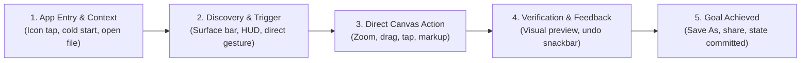
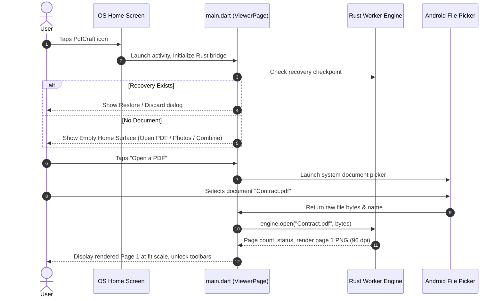
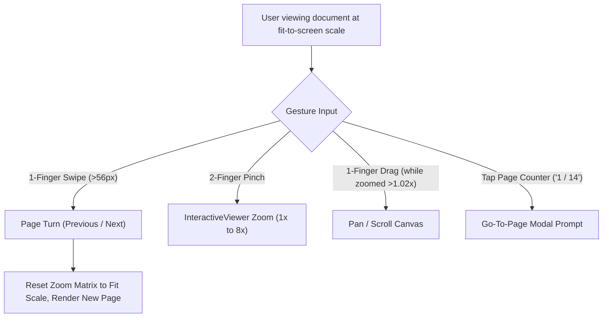
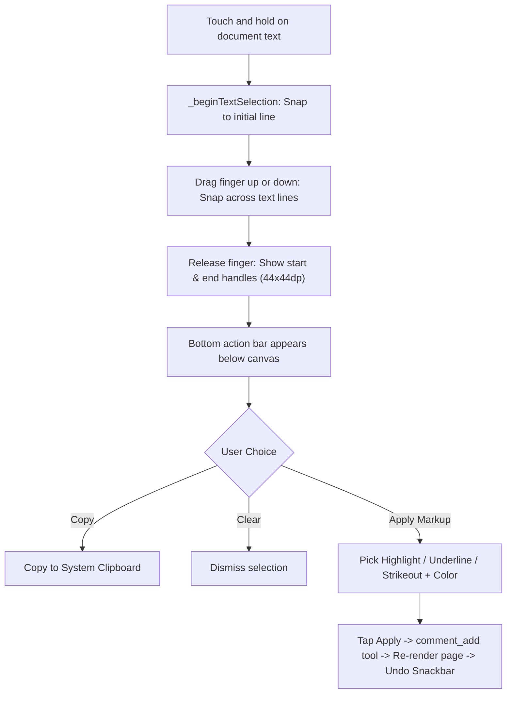
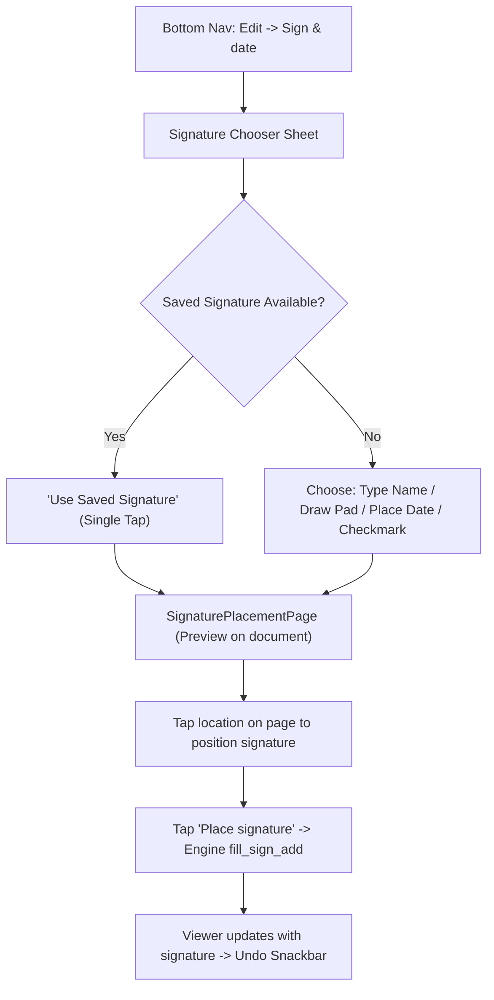
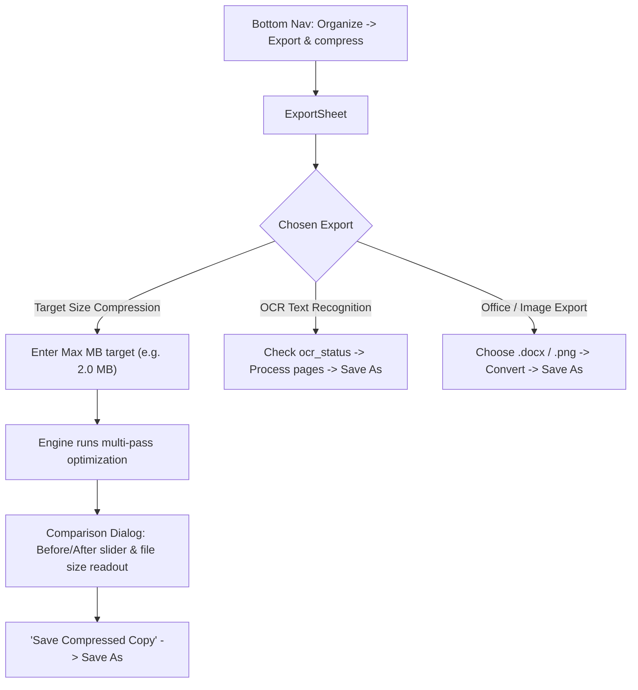
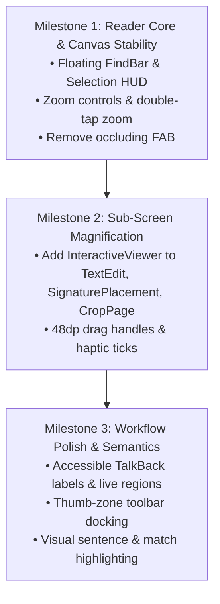

# PdfCraft Mobile: End-to-End Feature Interaction Model & UX Lifecycle Audit

**Audit Date:** October 2026  
**Target Codebase:** [`pdfcraft-mobile`](file:///home/sujay/Downloads/pdfcraft-mobile)  
**Scope:** Complete lifecycle of every feature from Home Screen icon tap $\rightarrow$ In-app manipulation $\rightarrow$ Goal achievement & persistence.  
**UX Standards Benchmarked:** Material Design 3, iOS Human Interface Guidelines (Preview / Files), WCAG 2.2 AA.

---

## 1. Global Interaction Lifecycle Architecture

In a professional mobile document utility, the user does not think in terms of "screens" or "widgets"; they think in terms of **goals**:
* *"I need to sign this contract and email it back."*
* *"I need to highlight three lines on page 4."*
* *"I need to reduce this PDF below 2 MB to upload it to a portal."*
* *"I need to delete page 2 and merge in another invoice."*

Every journey follows a 5-phase lifecycle:

Below, every feature and cluster of features in PdfCraft Mobile is audited through this complete lifecycle, contrasting **current as-built behavior** against **cutting-edge mobile UX best practices**.

---

## 2. Comprehensive Feature Lifecycles (Icon Tap $\rightarrow$ Goal Achieved)

---

### Flow 1: App Cold Start, Document Discovery & Home Ingestion
**Goal:** The user opens the app and successfully loads a PDF document ready for inspection or editing.

* **Current Implementation ([`main.dart#L1989-L2032`](file:///home/sujay/Downloads/pdfcraft-mobile/lib/main.dart#L1989-L2032)):**
  - Tap icon $\rightarrow$ `main()` launches `ViewerPage`.
  - While engine initializes, title row shows `"Starting engine"`.
  - Empty state displays 3 buttons: *Open a PDF* (Filled), *Create PDF from photos* (Outlined), *Combine PDF files* (Text).
  - Tapping *Open a PDF* opens Android system file picker.
  - On return, page 1 renders, but previous document is kept in memory until replaced.
* **Friction & Gaps:**
  - **No Recent Documents Carousel:** Users who tap the app icon to resume work on a recent PDF have to navigate Android's system file picker every time.
  - **Cold Start Flash:** Initial status text changes abruptly from `"Starting engine"` to `"Engine ready"`.
  - **No Drag-and-Drop / Intent Preview:** Opening a PDF from another app (e.g. WhatsApp or Gmail) doesn't have an immediate loading skeleton.
* **Cutting-Edge UX Best Practice:**
  1. **Instant Recent Files Deck:** Display a horizontal thumbnail strip of the last 3 accessed documents with file size and timestamp directly on the empty home screen.
  2. **Zero-Latency Skeleton Loader:** Show an animated subtle shimmer placeholder matching standard A4/Letter aspect ratio while page 1 renders.
  3. **One-Tap Quick Actions:** Keep "Scan via Camera" (future) and "Start Blank Document" alongside Open PDF.

---

### Flow 2: Pure Reading, Zooming & Multi-Axis Navigation
**Goal:** The user navigates, pans, and reads a multi-page document without accidental edits or disorientation.

* **Current Implementation ([`main.dart#L2108-L2152`](file:///home/sujay/Downloads/pdfcraft-mobile/lib/main.dart#L2108-L2152), [`page_viewport.dart`](file:///home/sujay/Downloads/pdfcraft-mobile/lib/widgets/page_viewport.dart)):**
  - Full page fitted to viewport via `fitPageScale()`.
  - Swipe threshold: deliberate 56px swipe turns page if scale $\le 1.02$.
  - When zoomed ($> 1.02$), swipe turns into panning.
  - Tapping page count (`1 / 14`) opens number input dialog.
* **Friction & Gaps:**
  - **Pinch-Only Zoom Exclusion:** No on-screen zoom buttons; completely inaccessible for one-handed operation or motor-impaired users (violates WCAG 2.5.1).
  - **Hard Page Transition:** Page flips abruptly replace the image with no slide animation, making it hard to track whether the page turned backward or forward.
  - **Zoom Loss on Page Turn:** Turning pages forcibly resets zoom to 100%, frustrating users reading dense small-font spreadsheets across pages.
* **Cutting-Edge UX Best Practice:**
  1. **Accessible Zoom Pill:** A floating micro-HUD at bottom-left with `[-]` `[ 100% ]` `[+]` and Double-Tap-to-Zoom (toggle between fit-width and 200%).
  2. **Continuous Horizontal Paging or Slide Physics:** Implement smooth horizontal transition physics so adjacent pages are visibly connected.
  3. **Maintain Zoom Option:** Option to lock zoom level across page turns for structured document review.

---

### Flow 3: In-Document Search & Text Traversal
**Goal:** User locates a specific keyword and steps through all occurrences across the document.

* **Lifecycle:**
  1. **Trigger:** User taps `Read` on bottom nav $\rightarrow$ taps `Find in PDF` row (or keyboard shortcut `Ctrl+F`).
  2. **Activation:** [`FindBar`](file:///home/sujay/Downloads/pdfcraft-mobile/lib/widgets/find_bar.dart) opens above the PDF canvas.
  3. **Execution:** User types search term $\rightarrow$ engine executes `text_find` $\rightarrow$ automatically navigates to Page of Match #1.
  4. **Traverse:** Tapping `▲` (previous) or `▼` (next) cycles through matches and jumps pages.
  5. **Dismiss:** Tapping `✕` dismisses find bar.
* **Friction & Gaps:**
  - **Layout Thrashing:** `FindBar` is injected into the vertical `Column`, shrinking the PDF canvas height and causing the page to rescale and leap.
  - **No In-Page Visual Match Highlights:** The engine reports the page number and text snippet, but the viewer does not render yellow bounding boxes over the matching words on the rendered page canvas! The user has to manually hunt for the word on that page.
  - **Touch Crowding:** 4 icon buttons and a label are packed into a single row on mobile.
* **Cutting-Edge UX Best Practice:**
  1. **Floating Search Pill HUD:** Float `FindBar` as an overlay anchored at the top of the viewport, with a frosted glass backdrop (`BackdropFilter`), leaving the underlying canvas dimensions frozen.
  2. **On-Canvas Highlighting of Active & Inactive Matches:** Fetch match bounding rects and highlight all occurrences on the visible page in translucent yellow, with the active occurrence in orange.

---

### Flow 4: Text Selection, Copying & Direct Annotation
**Goal:** User selects lines of text directly on the page and applies a highlight, underline, strikeout, or copies to clipboard.

* **Current Implementation ([`main.dart#L2127-L2230, L2293-L2385`](file:///home/sujay/Downloads/pdfcraft-mobile/lib/main.dart)):**
  - Long press starts line selection.
  - Dragging selects whole lines (`_pageTextLines`).
  - Selection handles appear at start and end.
  - Bottom action bar mounts below `Expanded` with Copy, Clear, SegmentedButton, color chips, and Apply button.
* **Friction & Gaps:**
  - **Severe Viewport Squeeze:** The action bar mounts into the `Column` below the PDF, shrinking viewport height by ~180dp and causing the page to suddenly shrink and reposition while the user is looking at the selection.
  - **Small Touch Handles:** Handles are $44\times 44\,\text{dp}$, violating Android 48dp minimums.
  - **Line-Level Snapping Only:** Cannot select individual words or characters.
* **Cutting-Edge UX Best Practice:**
  1. **Contextual Mini-Callout Bubble (iOS / Acrobat style):** Show a floating pill menu directly above the selected text block (with `Highlight`, `Underline`, `Strike`, `Copy`), keeping the main canvas stable.
  2. **Haptic Click on Line Snapping:** Fire light haptic feedback (`HapticFeedback.selectionClick()`) as the finger crosses each line boundary.
  3. **$48\times 48\,\text{dp}$ Touch Target Handles** with drop pins that lift above the finger so the finger does not obscure the insertion point.

---

### Flow 5: Freehand Drawing, Shapes, Measurement & Stamp Placement
**Goal:** User marks up the page with freehand ink, arrows, rectangles, measurements, stamps, or images.

* **Lifecycle:**
  1. **Trigger:** Bottom Nav `Edit` $\rightarrow$ `Draw & annotate` $\rightarrow$ opens full-screen [`AnnotatePage`](file:///home/sujay/Downloads/pdfcraft-mobile/lib/widgets/annotate_page.dart).
  2. **Tool Selection:** User picks mode from horizontal cluster: *Draw*, *Mark*, *Note*, *Text*, *Shape*, *Measure*, *More* (Stamps, Picture, Redact, Link).
  3. **Direct Manipulation:**
     - *Draw / Mark:* Single-finger drag draws smooth ink strokes on `CustomPaint`.
     - *Shapes:* Drag draws bounding box for Rectangle, Oval, Line, or Arrow.
     - *Stamp / Picture:* Tap page location $\rightarrow$ choose standard stamp (e.g. "APPROVED") or pick image from gallery $\rightarrow$ preview placed asset.
     - *Measure:* Tap two points $\rightarrow$ Euclidean distance calculated in points/inches.
  4. **Commit:** Tapping `Save` executes tool via engine $\rightarrow$ returns fresh status $\rightarrow$ updates viewer $\rightarrow$ shows snackbar with Undo.
* **Friction & Gaps:**
  - **Toolbar Shifting:** Tapping "Shape" or "More" toggles secondary variant rows, shifting the entire drawing canvas vertically.
  - **Accidental Ink during Pan:** Single finger touch draws ink; panning requires two fingers, causing accidental dots when users attempt to pan with one finger.
  - **Undo / Redo Isolation:** Undo within `AnnotatePage` only works before saving; once saved, it relies on main viewer undo stack.
* **Cutting-Edge UX Best Practice:**
  1. **Floating Docked Palette (Apple Pencil / Samsung S-Pen style):** Dock the pen/shape tool bar at the bottom edge as a floating island that collapses into an icon when drawing near it.
  2. **Palm Rejection & Explicit Pan Mode:** Dedicated Pan Hand tool toggle so one-finger drag can pan without drawing.
  3. **Real-time Geometric Snapping:** Automatically straighten lines and snap rectangles if user pauses for 300ms at the end of a stroke.

---

### Flow 6: In-Place Text Editing (Rewriting PDF Typography)
**Goal:** User replaces existing typographical text inside the PDF document without losing fonts or layouts.

* **Lifecycle:**
  1. **Trigger:** Bottom Nav `Edit` $\rightarrow$ `Edit existing text` $\rightarrow$ opens [`TextEditSheet`](file:///home/sujay/Downloads/pdfcraft-mobile/lib/widgets/text_edit_sheet.dart).
  2. **Detection:** Engine runs `text_paragraphs` for the active page, returning detected text blocks with font and bounding rects.
  3. **Targeting:** User taps near a paragraph on the scaled page image.
  4. **Rewrite:** Tapping `Edit selected text` opens dialog showing font family, size, and original text in a `TextField`.
  5. **Apply:** User types replacement string $\rightarrow$ engine executes `text_edit` $\rightarrow$ page re-renders $\rightarrow$ snackbar with Undo.
* **Friction & Gaps:**
  - **ZERO ZOOM IN TEXT EDIT SHEET:** The entire PDF page is rendered inside an $85\%$ height modal sheet at fit scale. On a 6-inch phone, 10pt text is completely unreadable and nearly impossible to tap accurately with a finger!
  - **42-Pixel Proximity Trap:** If the user's tap lands 43 pixels away from a paragraph boundary, it triggers an error snackbar: *"Tap near a line of text to select it"*.
* **Cutting-Edge UX Best Practice:**
  1. **`InteractiveViewer` Integration:** Wrap the page in full pinch-to-zoom and double-tap-to-zoom (up to 6x) so users can magnify paragraph blocks to comfortably readable sizes.
  2. **Visual Paragraph Highlight Cards:** Render subtle dashed outlines around all editable paragraphs so the user clearly sees what can be tapped.
  3. **Direct In-Line Editing Overlay:** Upon tapping a paragraph, render a native auto-sizing text input field directly over the bounding box instead of opening a detached modal dialog.

---

### Flow 7: Form Filling & Smart Prefill
**Goal:** User fills out interactive AcroForm fields (text boxes, checkboxes, radio groups, dropdowns) or imports existing data.

* **Lifecycle:**
  1. **Trigger:** Bottom Nav `Edit` $\rightarrow$ `Fill form` $\rightarrow$ opens [`FormScreen`](file:///home/sujay/Downloads/pdfcraft-mobile/lib/widgets/form_screen.dart).
  2. **Field Discovery:** Engine executes `form_fields`, generating a full-screen vertical list of form controls.
  3. **Input Options:**
     - *Manual:* User types into native text inputs, toggles checkboxes, picks dropdown items.
     - *Smart Prefill:* User taps "Use details to fill fields" $\rightarrow$ pastes text (e.g. `Name: John Doe`) $\rightarrow$ fuzzy matches labels $\rightarrow$ reviews checked matches $\rightarrow$ applies.
     - *Reset:* App bar menu $\rightarrow$ "Reset to defaults" $\rightarrow$ executes `form_reset`.
     - *Export / Import:* Menu $\rightarrow$ Export CSV/XFDF to Save As; or Import picker.
  4. **Commit:** Tapping `Save` executes `form_fill` $\rightarrow$ appearances regenerated $\rightarrow$ viewer updates.
* **Friction & Gaps:**
  - **Complete Disconnection from Document Canvas:** The form fields are presented as a raw abstract list on a blank screen. The user has no visual context of where each field appears on the real PDF.
  - **Cryptic Field Names:** PDFs generated by government or legacy enterprise software often have field names like `"topmostSubform[0].Page1[0].TextField_14"`, making an abstract list indecipherable.
* **Cutting-Edge UX Best Practice:**
  1. **Split-Screen or Focus-Zoom View:** When a field in the form drawer is selected, the background PDF smoothly pans and zooms directly to that field's visual location on the document.
  2. **Keyboard Navigation Next/Prev Bar:** Show an accessory bar above the on-screen keyboard with `< Previous` and `Next >` buttons to jump effortlessly between fields.

---

### Flow 8: Digital Signing & Date Placement
**Goal:** User creates or selects a signature/date and stamps it onto a signature line on the document.

* **Current Implementation ([`signature_placement_page.dart`](file:///home/sujay/Downloads/pdfcraft-mobile/lib/widgets/signature_placement_page.dart), [`signature_pad.dart`](file:///home/sujay/Downloads/pdfcraft-mobile/lib/widgets/signature_pad.dart), [`signature_store.dart`](file:///home/sujay/Downloads/pdfcraft-mobile/lib/services/signature_store.dart)):**
  - Chooser sheet checks `SignatureStore` for saved signature.
  - If drawing: [`SignaturePad`](file:///home/sujay/Downloads/pdfcraft-mobile/lib/widgets/signature_pad.dart) opens with finger canvas.
  - Placement page shows page image; user taps page to set `_draftPositionPx`.
  - Tapping "Place signature" executes `fill_sign_add`.
* **Friction & Gaps:**
  - **ZERO ZOOM ON PLACEMENT:** [`SignaturePlacementPage`](file:///home/sujay/Downloads/pdfcraft-mobile/lib/widgets/signature_placement_page.dart) has no `InteractiveViewer`. Placing a signature accurately onto a 2mm contract signature line on a mobile phone requires blind tapping.
  - **No Draggable Bounding Box:** Once tapped, the signature box cannot be dragged, rotated, or resized; tapping elsewhere simply moves it.
  - **Signature Pad Dark Mode Glare:** Hardcoded white background and black paint in `SignaturePad`.
* **Cutting-Edge UX Best Practice:**
  1. **Zoomable Placement Canvas with Movable Stamp Box:** Full `InteractiveViewer` zoom with a floating transformable box featuring corner handles to resize and drag the signature into perfect alignment.
  2. **Snapping to Form Signature Fields:** If the PDF has an AcroForm signature field, automatically offer: *"Snap signature to detected Signature Line on Page X"*.
  3. **Theme-Aware Signature Canvas:** Respect dark mode while exporting high-contrast transparent PNGs.

---

### Flow 9: Page Grid Organization, Reordering & Cropping
**Goal:** User reorganizes document structure (reorder, delete, rotate, duplicate, insert, or crop pages).

* **Lifecycle:**
  1. **Trigger:** Bottom Nav `Edit` $\rightarrow$ `Pages` $\rightarrow$ opens [`PageGrid`](file:///home/sujay/Downloads/pdfcraft-mobile/lib/widgets/page_grid.dart).
  2. **Interaction Modes:**
     - *Browse:* 3-column thumbnail grid with current-page indicator. Tapping jumps to page.
     - *Select:* Long-press enters multi-select. Header shows selection count. Bottom bar provides: *Select all*, *Extract N*, *Replace*, *Delete N*.
     - *Reorder Mode:* Header toggle switches grid to reorderable list with drag handles and accessible `▲` / `▼` buttons.
     - *Crop Page:* Page card menu $\rightarrow$ `Crop page` $\rightarrow$ opens [`CropPage`](file:///home/sujay/Downloads/pdfcraft-mobile/lib/widgets/crop_page.dart) $\rightarrow$ drag crop box $\rightarrow$ Apply.
* **Friction & Gaps:**
  - **No Zoom on `CropPage`:** Dragging crop boundaries on a small screen without magnification makes cropping fine margins error-prone.
  - **Accidental Card Taps:** Card tap targets in the 3-column grid collide with the card's 3-dot overflow menu icon.
  - **Grid Items Lack Semantics:** Screen readers cannot tell which page is selected or active.
* **Cutting-Edge UX Best Practice:**
  1. **Fluid Drag-and-Drop Grid with Reorder Animations:** Modern reorderable grid where long-pressing a thumbnail elevates it with haptic feedback, allowing users to drag and drop pages directly between positions in the grid.
  2. **Accessible Crop Loupe:** When dragging crop corner handles in `CropPage`, display an enlarged circular loupe (magnifying glass) above the finger.

---

### Flow 10: Multi-Document Assembly (Combine, Split, Photos-to-PDF)
**Goal:** User merges multiple files, converts camera photos into a document, or splits a large PDF.

* **Lifecycle:**
  1. **Trigger:** Bottom Nav `Organize` $\rightarrow$ `Create, combine & split` $\rightarrow$ opens [`OrganizeSheet`](file:///home/sujay/Downloads/pdfcraft-mobile/lib/widgets/organize_sheet.dart).
  2. **File Selection:** User picks external files via file picker.
  3. **Ordering:** [`FileOrderSheet`](file:///home/sujay/Downloads/pdfcraft-mobile/lib/widgets/file_order_sheet.dart) automatically inserts the currently open PDF as Item #1, letting the user arrange external files before merging.
  4. **Processing & Output:** Engine executes `doc_combine` or `doc_create_multiple` $\rightarrow$ outputs routed through [`saveToolOutputs`](file:///home/sujay/Downloads/pdfcraft-mobile/lib/widgets/output_saver.dart) to Android system "Save As".
* **Friction & Gaps:**
  - **Sheet Stacking Disorientation:** Navigating from Home $\rightarrow$ Organize Sheet $\rightarrow$ File Order Sheet $\rightarrow$ System Picker $\rightarrow$ System Save As creates a 5-layer modal stack.
  - **No Thumbnail Preview in Merge List:** [`FileOrderSheet`](file:///home/sujay/Downloads/pdfcraft-mobile/lib/widgets/file_order_sheet.dart) shows filename strings, but no visual cover thumbnail of the files being merged.
* **Cutting-Edge UX Best Practice:**
  1. **Visual Card Deck for Merge Files:** Show first-page preview cards in the file ordering sheet.
  2. **Direct In-App Result Viewing:** After combining, ask: *"Combined PDF ready. [Open Now] or [Share/Save As]"*, rather than forcing an immediate system file save dialog.

---

### Flow 11: Security, Sanitization & Permanent Redaction
**Goal:** User permanently sanitizes confidential data or protects the PDF with an owner/user password.

* **Lifecycle:**
  1. **Trigger:** Bottom Nav `Organize` $\rightarrow$ `Protect & redact` $\rightarrow$ opens [`SecureSheet`](file:///home/sujay/Downloads/pdfcraft-mobile/lib/widgets/secure_sheet.dart).
  2. **Actions:**
     - *Redact Phrase:* Type term $\rightarrow$ executes `redact_mark` $\rightarrow$ marks appear on page $\rightarrow$ tapping "Apply redactions" executes `redact_apply` (destructive confirmation dialog required) $\rightarrow$ permanent black box burned into PDF.
     - *Password Protect:* Enter password $\rightarrow$ executes `doc_protect` $\rightarrow$ encryption applied.
     - *Remove Hidden Data:* Executes `doc_remove_hidden` (metadata, thumbnails, annotations sanitized).
* **Friction & Gaps:**
  - **No Visual Pre-Bake Inspection:** Once phrase redactions are marked, the user has to close the sheet to inspect the page before reopening the sheet to click "Apply".
  - **Irreversible Step Confusion:** Users often do not realize whether redactions are merely drafted or permanently baked in.
* **Cutting-Edge UX Best Practice:**
  1. **Live Redaction Audit Mode:** When entering Redaction mode, dim the viewer and render bright red callouts over all matches with an on-screen floating bar showing: *"3 items marked for redaction. [Review on Page] [Burn In Permanently]"*.
  2. **Clear Security Shield Indicator:** Display a persistent lock badge in the top app bar when password protection or redaction is active.

---

### Flow 12: Export, Compression & Conversion
**Goal:** User exports the PDF to Word/images, runs OCR, or compresses the file to meet an email or upload size limit (e.g. $< 2\,\text{MB}$).

* **Current Implementation ([`export_sheet.dart`](file:///home/sujay/Downloads/pdfcraft-mobile/lib/widgets/export_sheet.dart)):**
  - Grouped into *Convert*, *Improve*, and *Review* sections.
  - Target-size compression tests 6 profiles, then shows comparison dialog with `InteractiveViewer(minScale: 1, maxScale: 5)` and Original/Compressed toggle.
* **Friction & Gaps:**
  - **Small Compression Comparison Viewport:** The comparison viewer inside the dialog is restricted to $34\%$ of dialog height, making visual degradation checks difficult.
  - **Silent Progress:** Long compression or OCR tasks update progress in text that lacks `Semantics(liveRegion: true)`.
* **Cutting-Edge UX Best Practice:**
  1. **Split-Screen or Curtain Slider (Before/After):** A full-height swipeable vertical divider showing original resolution on the left and compressed resolution on the right.
  2. **Estimated Savings Badge:** Real-time feedback showing: *"Reduced from 8.4 MB to 1.8 MB (78% smaller)"* in high-contrast success green.

---

### Flow 13: Comments, Notes & Collaborative Review
**Goal:** User reviews notes, responds to threads, or updates review status (Accepted / Rejected / Completed).

* **Lifecycle:**
  1. **Trigger:** Tap on-page comment pin ($48\times 48\,\text{dp}$) OR Bottom Nav `Read` $\rightarrow$ `Comments` $\rightarrow$ opens [`CommentsScreen`](file:///home/sujay/Downloads/pdfcraft-mobile/lib/widgets/comments_screen.dart).
  2. **List & Filter:** Comments grouped by page, showing author, date, text, status pill, and reply list.
  3. **Actions:** Tap card header jumps to that page; buttons allow: *Reply*, *Set status*, *Mark*, *Lock*, *Edit*, *Delete*.
  4. **Export:** App bar action "Summarize to PDF" writes comment report to Save As.
* **Friction & Gaps:**
  - **Crowded Action Wrap:** 7 small buttons inside each comment card with 0dp spacing cause frequent mis-taps.
  - **Disconnected Reply Input:** Adding a reply opens a nested sheet rather than an inline messaging thread.
* **Cutting-Edge UX Best Practice:**
  1. **Accordion Thread Cards:** Clean primary cards with an expandable reply drawer and single 3-dot overflow menu for secondary actions (Lock, Delete, Status).
  2. **Direct Visual Linkage:** Tapping a comment card splits the screen or anchors an arrow pointing directly to the pinned location on the page.

---

### Flow 14: Document Intelligence & Evidence Discovery
**Goal:** User asks a question or requests a summary, receiving sourced citations linked to exact sentences in the PDF.

* **Lifecycle:**
  1. **Trigger:** Bottom Nav `Read` $\rightarrow$ `Summary & evidence` $\rightarrow$ opens [`DocumentInsightsSheet`](file:///home/sujay/Downloads/pdfcraft-mobile/lib/widgets/document_insights_sheet.dart).
  2. **Processing:** Engine runs `doc_export_text`, extracting plain text into memory.
  3. **Queries:** User enters search prompt or taps "Summarize".
  4. **Results:** List of top 5 extractive summary sentences or top 8 sourced excerpts with Page badges.
  5. **Navigation:** Tapping any excerpt instantly jumps the viewer to that page.
* **Friction & Gaps:**
  - **Sheet Dismissal on Jump:** Tapping a result dismisses the sheet completely; if the user wants to inspect the next citation, they have to reopen the sheet and re-run the search.
  - **No On-Canvas Sentence Focus:** The viewer jumps to the page, but does not highlight or box the actual sentence found.
* **Cutting-Edge UX Best Practice:**
  1. **Collapsible Bottom Drawer HUD:** Allow the insights sheet to collapse into a compact bottom pill (`Excerpt 1 of 8`), stepping through citations with `<` and `>` while viewing the page.
  2. **Temporary Pulse Highlight:** Render a soft glowing animated box over the target sentence for 2 seconds upon landing on the page.

---

### Flow 15: AI Assistant Command Routing
**Goal:** User types a request in natural language and gets routed to the appropriate verified engine flow.

* **Lifecycle:**
  1. **Trigger:** Bottom Nav `Agent` (or bottom-right "Ask" FAB) $\rightarrow$ opens [`AgentCommandSheet`](file:///home/sujay/Downloads/pdfcraft-mobile/lib/widgets/agent_command_sheet.dart).
  2. **Input:** User types a request (e.g. *"Compress below 2 MB"* or *"Highlight dates"*) or taps a sample prompt chip.
  3. **Routing:** `routePdfRequest()` parses intent offline and maps it to a safe reviewed UI workflow (e.g. `compress`, `forms`, `sign`).
  4. **Feedback:** Returns to main screen, triggers the destination workflow, and displays a "Done — \<task\>" snackbar.
* **Friction & Gaps:**
  - **Dual Trigger Clutter:** Both the bottom navigation tab and the floating FAB trigger the exact same sheet.
  - **Lack of Conversational Context:** Sheet immediately dismisses without showing what tool or arguments were matched.
* **Cutting-Edge UX Best Practice:**
  1. **Consolidated Trigger:** Remove the permanent floating FAB; place a modern search/agent pill at the top of the screen or keep in the nav bar.
  2. **Confirmation Pill:** Show a brief animated chip before transition: *"Routing to Compress below 2MB → [Confirm]"*.

---

### Flow 16: Document Persistence, Export & Auto-Recovery Lifecycle
**Goal:** User preserves edits safely without data loss, even across battery death or app crashes.

* **Lifecycle:**
  1. **Checkpointing:** Any mutating engine call automatically stages a recovery snapshot in app-private storage (`recovery/recovery.pdf`). Title bar displays `"• Unsaved · recovery saved"`.
  2. **Explicit Save:** User taps `Save` in app bar $\rightarrow$ engine writes incremental save to workspace.
  3. **Export / Share:** User taps `Share` $\rightarrow$ app exports clean copy to Android share sheet (Gmail, Drive, WhatsApp).
  4. **System Save As:** Tools producing new files route through [`saveToolOutputs`](file:///home/sujay/Downloads/pdfcraft-mobile/lib/widgets/output_saver.dart) to the Android SAF system picker.
  5. **Crash Recovery:** If app terminates unexpectedly, next launch detects recovery file and prompts: *Restore / Discard / Keep for later*.
* **Friction & Gaps:**
  - **Lack of Visual Dirty Confirmation:** Users often wonder if their edits are safely saved to their device's original file location vs internal app staging.
* **Cutting-Edge UX Best Practice:**
  1. **Unsaved Indicator & Auto-Save Badge:** An unobtrusive status pill next to the document title: `[Saved ✓]` or `[Unsaved •]`.
  2. **Direct Overwrite Save Support:** When opened via Storage Access Framework, allow direct in-place save without forcing "Save As" on every edit.

---

## 3. Cross-Cutting Modern UX Guidelines for Implementation

To deliver a cutting-edge mobile experience across all 16 lifecycles, the following standards must be applied universally:

### 3.1 Thumb-Zone Ergonomics
* All primary triggers and interactive controls must sit in the lower $40\%$ of the screen (the comfortable one-handed reach zone on modern tall phones).
* Destructive actions (Delete, Discard) must be separated from primary confirmation buttons with distinct colors and explicit confirmation modals.

### 3.2 Viewport Isolation (No Layout Jitter)
* **Golden Rule:** The PDF canvas dimensions (`constraints.maxWidth`, `constraints.maxHeight`) must NEVER resize when toolbars, search bars, or selection controls appear.
* All accessory chrome must float as non-reflowing overlays (`Stack` with `Positioned` or bottom sheets that slide over rather than push the canvas).

### 3.3 Haptic Design
* **Selection Snap:** `HapticFeedback.selectionClick()` when text selection crosses line boundaries.
* **Tool Commit:** `HapticFeedback.lightImpact()` on tool execution (signature placed, stamp added, page deleted).
* **Destructive Action:** `HapticFeedback.heavyImpact()` on permanent redaction or page deletion.

### 3.4 Motor & Visual Accessibility
* Every canvas where the user touches or positions assets ([`TextEditSheet`](file:///home/sujay/Downloads/pdfcraft-mobile/lib/widgets/text_edit_sheet.dart), [`SignaturePlacementPage`](file:///home/sujay/Downloads/pdfcraft-mobile/lib/widgets/signature_placement_page.dart), [`CropPage`](file:///home/sujay/Downloads/pdfcraft-mobile/lib/widgets/crop_page.dart), [`QuickMarkPage`](file:///home/sujay/Downloads/pdfcraft-mobile/lib/widgets/quick_mark_page.dart)) **must support `InteractiveViewer` magnification**.
* Touch targets must maintain a minimum bounding box of $48\times 48\,\text{dp}$.
* Single-pointer Zoom In / Zoom Out controls must accompany all pinch-to-zoom surfaces (WCAG 2.5.1).

---

## 4. Prioritized Feature Implementation Plan

| Phase | Target Scope | Core Deliverables |
| :--- | :--- | :--- |
| **Phase 1: Reader Core (P0)** | Viewport Stability, Main Viewer, Search | • Freeze PDF viewport geometry (convert `FindBar` and selection bar to floating overlays) • Add accessible Zoom buttons and double-tap zoom • Remove occluding FAB from reading canvas |
| **Phase 2: Precision Editing (P1)** | Signature, Text Edit, Crop, Annotate | • Add `InteractiveViewer` to `TextEditSheet`, `SignaturePlacementPage`, `CropPage` • Enlarge selection handles to 48dp with haptic feedback • Theme-aware signature pad (dark mode support) |
| **Phase 3: Accessibility & Polish (P2)** | Semantics, Forms, Navigation, Insights | • Add full `Semantics` tree for TalkBack/VoiceOver across canvases and grids • Mark search counts and task progress as live regions • Refactor bottom nav bar into persistent docked surface drawer |
