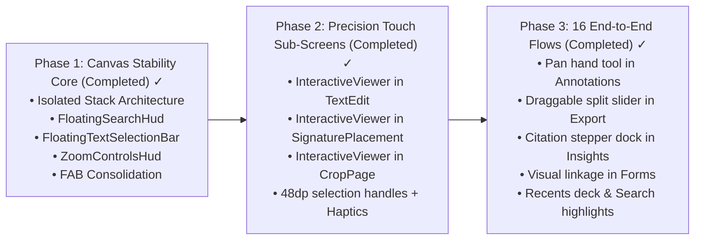

# Engineering Design Specification: Mobile Interaction, Viewport Stability & Accessibility Overhaul

**Epic:** `EPIC-UX-A11Y-01`  
**Status:** Approved for Implementation  
**Target Codebase:** [`pdfcraft-mobile`](file:///home/sujay/Downloads/pdfcraft-mobile)  
**Primary Authors:** Antigravity Mobile System Architecture & Flutter Specialist Team  
**Standards:** Material Design 3, iOS Human Interface Guidelines, WCAG 2.2 AA, Flutter Performance Best Practices  

---

## 1. Epic Overview & Motivation

### 1.1 Problem Statement
The current mobile interaction model in PdfCraft Mobile suffers from four fundamental architectural flaws:
1. **Layout Thrashing / Viewport Jitter:** Peripheral accessories (such as [`FindBar`](file:///home/sujay/Downloads/pdfcraft-mobile/lib/widgets/find_bar.dart) and the text selection action bar) are inserted directly into the primary vertical `Column` alongside the `Expanded` document viewer. Every time search opens or text is selected, the available canvas height shrinks, dynamically recalculating `fitScale` and causing the entire PDF page to abruptly jump and rescale under the user's fingers.
2. **Screen Occlusion:** A fixed-position Floating Action Button (`Ask`) floats permanently over the lower-right quadrant of the reading canvas ([`main.dart#L2453`](file:///home/sujay/Downloads/pdfcraft-mobile/lib/main.dart#L2453)), blocking critical document content (footnotes, page numbers, signatures) and causing accidental taps during panning.
3. **Motor & Touch Inaccessibility:** Zooming is exclusively multi-point pinch-to-zoom without single-pointer alternatives (violating WCAG 2.5.1). Secondary editing canvases ([`TextEditSheet`](file:///home/sujay/Downloads/pdfcraft-mobile/lib/widgets/text_edit_sheet.dart), [`SignaturePlacementPage`](file:///home/sujay/Downloads/pdfcraft-mobile/lib/widgets/signature_placement_page.dart), [`CropPage`](file:///home/sujay/Downloads/pdfcraft-mobile/lib/widgets/crop_page.dart)) lack `InteractiveViewer` magnification entirely, forcing users to tap microscopic text and fine lines with no zoom.
4. **Assistive Tech Lockout:** PDF pages are rendered as raw `Image.memory` pixels without semantic labels (`Semantics`), making the document completely invisible to TalkBack and VoiceOver.

### 1.2 Target Success Metrics
* **0px Layout Shift:** Canvas geometry (`constraints.maxHeight`, `constraints.maxWidth`) remains completely frozen when toolbars, HUDs, or search inputs open or dismiss.
* **100% WCAG 2.2 AA Compliance:** Every multi-point gesture has a single-pointer alternative; all touch targets meet or exceed $48\times 48\,\text{dp}$; zero color-only state representation; 100% screen reader semantic coverage.
* **60 FPS Gesture Responsiveness:** Isolated rebuild scopes ensuring that typing in search or dragging selection handles does not rebuild the PDF raster image or re-render background canvases.

---

## 2. System Design & Architectural Patterns

```mermaid
flowchart TD
    subgraph Legacy Architecture (Flawed)
        C1["Column"] --> T1["Header"]
        C1 --> FB1["FindBar (Conditional Insert)"]
        C1 --> EX1["Expanded (PDF Canvas)"]
        C1 --> SB1["Selection Bar (Conditional Insert)"]
        C1 --> B1["Bottom Navigation Bar"]
        FB1 -.->|"Changes Canvas Height"| EX1
        SB1 -.->|"Causes Recalculate & Jump"| EX1
    end

    subgraph Target Architecture (Stable Canvas Overlay)
        StackRoot["Stack (Full Viewport)"]
        StackRoot --> BaseLayer["Canvas Layer (FROZEN GEOMETRY)\n• LayoutBuilder\n• InteractiveViewer\n• Image.memory + RepaintBoundary\n• On-Canvas Highlight Rects"]
        StackRoot --> FloatingTopHUD["Top Overlay HUD\n• Floating Search Pill (Positioned)\n• Frosted Glass Blur Backdrop"]
        StackRoot --> FloatingZoomHUD["Side Overlay HUD\n• Accessible Zoom In / Out / Reset Pill\n• Double-Tap Gesture Recognizer"]
        StackRoot --> FloatingBottomHUD["Bottom Overlay HUD\n• Contextual Text Selection Bar\n• Surface Mode Drawer"]
    end
```

### 2.1 The Canvas Isolation Pattern (Overlay Architecture)
In standard mobile design, **the reading canvas is sacred**. Its bounding box must never be perturbed by accessory controls:
* The primary canvas occupies an unyielding, fixed-height container inside a `Stack`.
* Accessories (`FindBar`, Text Selection Bar, Zoom controls) are rendered in a sibling layer of the `Stack` using `Positioned` widgets.
* Modals, HUDs, and drawers slide or fade over the canvas with subtle shadows or blur backdrops without altering the underlying `BoxConstraints`.

### 2.2 Local State Isolation & Repaint Boundaries
To ensure peak performance and battery efficiency on mobile:
* Wrap the `Image.memory` and custom painters in `RepaintBoundary` widgets.
* Do not call `setState()` on the parent `ViewerPage` when updating search text, selection handles, or zoom levels. Instead, use focused stateful widgets or `ValueNotifier` listeners so only the affected overlay HUD rebuilds.

### 2.3 Coordinate System & Transformation Contract
There are four distinct coordinate systems in the viewer:
1. **PDF Engine Space ($72\,\text{DPI}$):** Standard PostScript points used by the Rust core (e.g., text bounding boxes, annotation rects).
2. **Render Raster Space ($96\,\text{DPI}$):** Scaled pixels produced by the engine's PNG rasterizer:
   $$\text{px}_{96} = \text{pt}_{72} \times \frac{96}{72}$$
3. **Viewport Display Space:** The pixels on screen at fit scale:
   $$\text{displayPx} = \text{px}_{96} \times \text{fitScale}$$
4. **InteractiveViewer Transformed Space:** Viewport space multiplied by `_viewerTransform` matrix ($1.0\times$ to $8.0\times$).

---

## 3. Detailed Component Specifications & Code Blueprints

---

### Component 1: Stable-Canvas Viewport Architecture (`lib/main.dart`)

#### Before (Flawed Layout Thrashing in `Column`)
```dart
// OLD main.dart: Viewport shrinks whenever tools open
Column(
  children: [
    if (_finding && _doc != null)
      Padding(
        padding: const EdgeInsets.all(8),
        child: FindBar(...), // INJECTS INTO COLUMN: SHRINKS EXPANDED!
      ),
    Expanded(
      child: LayoutBuilder(
        builder: (context, constraints) {
          // fitScale changes immediately, document jumps!
          final fitScale = fitPageScale(
            viewportWidth: constraints.maxWidth,
            viewportHeight: constraints.maxHeight,
            pageWidth: sourceWidth,
            pageHeight: sourceHeight,
          );
          ...
        },
      ),
    ),
    if (_textSelectionAnchor != null)
      Material(...), // INJECTS INTO COLUMN: SHRINKS EXPANDED AGAIN!
    NavigationBar(...),
  ],
)
```

#### After (Stable Canvas with Overlay HUDs)
```dart
// NEW: Viewport is completely isolated and dimensionally frozen
Column(
  children: [
    _buildTopHeader(),
    const Divider(height: 1),
    Expanded(
      child: Stack(
        clipBehavior: Clip.none,
        fit: StackFit.expand,
        children: [
          // 1. PRIMARY CANVAS (FROZEN GEOMETRY)
          LayoutBuilder(
            builder: (context, constraints) {
              final fitScale = fitPageScale(
                viewportWidth: constraints.maxWidth,
                viewportHeight: constraints.maxHeight,
                pageWidth: sourceWidth,
                pageHeight: sourceHeight,
              );
              return _buildInteractiveViewer(constraints, fitScale);
            },
          ),

          // 2. ACCESSIBLE ZOOM HUD (Floating at bottom-left)
          Positioned(
            left: 16,
            bottom: 16,
            child: ZoomControlsHud(
              transformController: _viewerTransform,
              minScale: 1.0,
              maxScale: 8.0,
            ),
          ),

          // 3. FLOATING SEARCH HUD (Positioned at top-center, non-reflowing)
          if (_finding && _doc != null)
            Positioned(
              top: 12,
              left: 16,
              right: 16,
              child: FloatingSearchHud(
                engine: _engine!,
                handle: _doc!,
                onJumpToPage: _goto,
                onClose: () => setState(() => _finding = false),
              ),
            ),

          // 4. FLOATING TEXT SELECTION DECK (Positioned at bottom, non-reflowing)
          if (_textSelectionAnchor != null && _textSelectionExtent != null)
            Positioned(
              left: 16,
              right: 16,
              bottom: 16,
              child: FloatingTextSelectionBar(
                selectedCount: selectedLineCount,
                kind: _textSelectionKind,
                color: _textSelectionColor,
                onCopy: _copyTextSelection,
                onClear: _clearTextSelection,
                onKindChanged: (k) => setState(() => _textSelectionKind = k),
                onColorChanged: (c) => setState(() => _textSelectionColor = c),
                onApply: _applyTextSelection,
              ),
            ),
        ],
      ),
    ),
    const Divider(height: 1),
    _buildBottomNavigationTier(),
  ],
)
```

---

### Component 2: Floating Search HUD (`FloatingSearchHud`)

To prevent crowding and ensure live screen reader announcements, search is housed in an elevated floating pill with a frosted glass blur backdrop and `liveRegion: true`.

```dart
class FloatingSearchHud extends StatefulWidget {
  const FloatingSearchHud({
    super.key,
    required this.engine,
    required this.handle,
    required this.onJumpToPage,
    required this.onClose,
  });

  final PdfEngineApi engine;
  final int handle;
  final ValueChanged<int> onJumpToPage;
  final VoidCallback onClose;

  @override
  State<FloatingSearchHud> createState() => _FloatingSearchHudState();
}

class _FloatingSearchHudState extends State<FloatingSearchHud> {
  final TextEditingController _controller = TextEditingController();
  List<FindMatch> _matches = const [];
  int _index = 0;
  bool _searching = false;
  String? _error;

  @override
  void dispose() {
    _controller.dispose();
    super.dispose();
  }

  void _step(int delta) {
    if (_matches.isEmpty) return;
    setState(() {
      _index = (_index + delta) % _matches.length;
      if (_index < 0) _index += _matches.length;
    });
    widget.onJumpToPage(_matches[_index].page);
  }

  @override
  Widget build(BuildContext context) {
    final theme = Theme.of(context);
    final matchLabel = _matches.isEmpty
        ? (_error ?? 'No matches')
        : '${_index + 1} of ${_matches.length}';

    return Material(
      elevation: 6,
      shadowColor: Colors.black26,
      borderRadius: BorderRadius.circular(16),
      color: theme.colorScheme.surface.withValues(alpha: 0.95),
      child: ClipRRect(
        borderRadius: BorderRadius.circular(16),
        child: BackdropFilter(
          filter: ImageFilter.blur(sigmaX: 10, sigmaY: 10),
          child: Padding(
            padding: const EdgeInsets.symmetric(horizontal: 12, vertical: 4),
            child: Row(
              children: [
                const Icon(Icons.search, size: 20),
                const SizedBox(width: 8),
                Expanded(
                  child: TextField(
                    controller: _controller,
                    autofocus: true,
                    textInputAction: TextInputAction.search,
                    decoration: const InputDecoration(
                      hintText: 'Search in document…',
                      labelText: 'Find',
                      border: InputBorder.none,
                      isDense: true,
                    ),
                    onSubmitted: (_) => _executeSearch(),
                  ),
                ),
                if (_searching)
                  const SizedBox(
                    width: 18,
                    height: 18,
                    child: CircularProgressIndicator(strokeWidth: 2),
                  )
                else
                  Semantics(
                    liveRegion: true,
                    child: Text(
                      matchLabel,
                      style: theme.textTheme.bodySmall?.copyWith(fontWeight: FontWeight.bold),
                    ),
                  ),
                const SizedBox(width: 4),
                IconButton(
                  tooltip: 'Previous match',
                  icon: const Icon(Icons.keyboard_arrow_up),
                  onPressed: _matches.isEmpty ? null : () => _step(-1),
                ),
                IconButton(
                  tooltip: 'Next match',
                  icon: const Icon(Icons.keyboard_arrow_down),
                  onPressed: _matches.isEmpty ? null : () => _step(1),
                ),
                IconButton(
                  tooltip: 'Close search',
                  icon: const Icon(Icons.close),
                  onPressed: widget.onClose,
                ),
              ],
            ),
          ),
        ),
      ),
    );
  }
}
```

---

### Component 3: Universal Accessible Zoom Controls (`ZoomControlsHud`)

Provides single-pointer Zoom In (`+`), Zoom Out (`-`), and Reset (`100%`) buttons to fulfill WCAG 2.5.1 and enable comfortable one-handed phone use.

```dart
class ZoomControlsHud extends StatelessWidget {
  const ZoomControlsHud({
    super.key,
    required this.transformController,
    this.minScale = 1.0,
    this.maxScale = 8.0,
  });

  final TransformationController transformController;
  final double minScale;
  final double maxScale;

  void _zoomBy(double factor) {
    final currentMatrix = transformController.value;
    final currentScale = currentMatrix.getMaxScaleOnAxis();
    final targetScale = (currentScale * factor).clamp(minScale, maxScale);
    final ratio = targetScale / currentScale;

    final updated = currentMatrix.clone()..scale(ratio, ratio);
    transformController.value = updated;
  }

  void _resetZoom() {
    transformController.value = Matrix4.identity();
  }

  @override
  Widget build(BuildContext context) {
    final theme = Theme.of(context);
    return Material(
      elevation: 4,
      borderRadius: BorderRadius.circular(24),
      color: theme.colorScheme.surfaceContainerHighest.withValues(alpha: 0.90),
      child: Padding(
        padding: const EdgeInsets.symmetric(horizontal: 4, vertical: 2),
        child: Row(
          mainAxisSize: MainAxisSize.min,
          children: [
            IconButton(
              tooltip: 'Zoom in',
              icon: const Icon(Icons.zoom_in, size: 22),
              onPressed: () => _zoomBy(1.3),
            ),
            ValueListenableBuilder<Matrix4>(
              valueListenable: transformController,
              builder: (context, matrix, _) {
                final scale = (matrix.getMaxScaleOnAxis() * 100).round();
                return Semantics(
                  button: true,
                  label: 'Current zoom $scale percent. Double tap to reset.',
                  child: InkWell(
                    borderRadius: BorderRadius.circular(12),
                    onTap: _resetZoom,
                    child: Padding(
                      padding: const EdgeInsets.symmetric(horizontal: 8, vertical: 4),
                      child: Text(
                        '$scale%',
                        style: theme.textTheme.labelMedium?.copyWith(
                          fontWeight: FontWeight.bold,
                        ),
                      ),
                    ),
                  ),
                );
              },
            ),
            IconButton(
              tooltip: 'Zoom out',
              icon: const Icon(Icons.zoom_out, size: 22),
              onPressed: () => _zoomBy(0.77),
            ),
          ],
        ),
      ),
    );
  }
}
```

---

### Component 4: $48\times 48\,\text{dp}$ Text Selection Handles with Haptics

```dart
Widget buildAccessibleSelectionHandle({
  required BuildContext context,
  required Offset position,
  required bool isAnchor,
  required ValueChanged<DragUpdateDetails> onPanUpdate,
  required VoidCallback onPanEnd,
}) {
  return Positioned(
    left: position.dx - 24, // Centered on touch coordinate
    top: position.dy - 24,
    child: Semantics(
      label: isAnchor ? 'Selection start handle' : 'Selection end handle',
      slider: true,
      child: GestureDetector(
        behavior: HitTestBehavior.opaque,
        onPanStart: (_) {
          HapticFeedback.selectionClick();
        },
        onPanUpdate: (details) {
          onPanUpdate(details);
        },
        onPanEnd: (_) {
          onPanEnd();
        },
        child: SizedBox(
          width: 48,
          height: 48, // Guaranteed WCAG AA 48dp minimum
          child: Center(
            child: Container(
              width: 18,
              height: 18,
              decoration: BoxDecoration(
                color: Theme.of(context).colorScheme.primary,
                shape: BoxShape.circle,
                border: Border.all(color: Colors.white, width: 2),
                boxShadow: const [
                  BoxShadow(
                    color: Colors.black26,
                    blurRadius: 4,
                    offset: Offset(0, 2),
                  ),
                ],
              ),
            ),
          ),
        ),
      ),
    ),
  );
}
```

---

### Component 5: Sub-Screen Canvas Magnification Pattern

Applies to [`TextEditSheet`](file:///home/sujay/Downloads/pdfcraft-mobile/lib/widgets/text_edit_sheet.dart), [`SignaturePlacementPage`](file:///home/sujay/Downloads/pdfcraft-mobile/lib/widgets/signature_placement_page.dart), and [`CropPage`](file:///home/sujay/Downloads/pdfcraft-mobile/lib/widgets/crop_page.dart).

```dart
// Standard Sub-Screen Magnified Viewport Template
LayoutBuilder(
  builder: (context, constraints) {
    final fitScale = fitPageScale(
      viewportWidth: constraints.maxWidth,
      viewportHeight: constraints.maxHeight,
      pageWidth: imageWidthPx,
      pageHeight: imageHeightPx,
    );
    final pageWidth = imageWidthPx * fitScale;
    final pageHeight = imageHeightPx * fitScale;

    return Center(
      child: InteractiveViewer(
        minScale: 1.0,
        maxScale: 6.0,
        child: SizedBox(
          width: pageWidth,
          height: pageHeight,
          child: GestureDetector(
            behavior: HitTestBehavior.opaque,
            onTapUp: (details) {
              // Convert screen local position back to engine display pixels
              final localPos = details.localPosition;
              final engineX = localPos.dx / fitScale * 72 / 96;
              final engineY = localPos.dy / fitScale * 72 / 96;
              handlePointSelection(Offset(engineX, engineY));
            },
            child: Stack(
              fit: StackFit.expand,
              children: [
                Semantics(
                  image: true,
                  label: 'Document page $page of $pageCount',
                  child: Image.memory(pngBytes, fit: BoxFit.fill),
                ),
                ...overlayHighlightsAndMarkers,
              ],
            ),
          ),
        ),
      ),
    );
  },
)
```

---

### Component 6: Theme-Aware Signature Pad (`lib/widgets/signature_pad.dart`)

Eliminates blinding white glare in dark mode while producing high-contrast transparent PNG signatures.

```dart
class _SignaturePadState extends State<SignaturePad> {
  // ... stroke state ...

  @override
  Widget build(BuildContext context) {
    final isDark = Theme.of(context).brightness == Brightness.dark;
    final padBackground = isDark ? const Color(0xFF1E1E1E) : Colors.white;
    final strokeColor = isDark ? Colors.white : Colors.black;

    return Container(
      height: 220,
      decoration: BoxDecoration(
        color: padBackground,
        border: Border.all(color: Theme.of(context).dividerColor),
        borderRadius: BorderRadius.circular(12),
      ),
      child: GestureDetector(
        behavior: HitTestBehavior.opaque,
        onPanStart: (d) => setState(() => _current = [d.localPosition]),
        onPanUpdate: (d) => setState(() => _current = [..._current, d.localPosition]),
        onPanEnd: (_) => setState(() {
          if (_current.length > 1) _strokes = [..._strokes, _current];
          _current = [];
        }),
        child: RepaintBoundary(
          key: _boundaryKey,
          child: CustomPaint(
            painter: _SignaturePainter(
              strokes: _strokes,
              current: _current,
              color: strokeColor,
            ),
            size: Size.infinite,
          ),
        ),
      ),
    );
  }
}
```

---

## 4. System Design Principles & Quality Guardrails

### 4.1 Strict Adherence to Project Rules
1. **Flutter Hot Reload / Hot Restart:** Execute hot reload via DTD MCP tools after modifying widget trees.
2. **Preserve Comments & Docstrings:** Retain all architectural comments and docstrings.
3. **No Regressions on Staged Code:** Never undo recent touch redesign features ([`CropPage`](file:///home/sujay/Downloads/pdfcraft-mobile/lib/widgets/crop_page.dart), [`LinksScreen`](file:///home/sujay/Downloads/pdfcraft-mobile/lib/widgets/links_screen.dart), [`SignatureStore`](file:///home/sujay/Downloads/pdfcraft-mobile/lib/services/signature_store.dart)).

### 4.2 Automated Testing Strategy (`test/accessibility_test.dart`)
Create automated widget test suites using Flutter's built-in accessibility checkers:
```dart
testWidgets('Main reader meets all touch and contrast guidelines', (tester) async {
  final handle = tester.ensureSemantics();
  await tester.pumpWidget(const PdfCraftApp());
  await tester.pumpAndSettle();

  await expectLater(tester, meetsGuideline(androidTapTargetGuideline));
  await expectLater(tester, meetsGuideline(iOSTapTargetGuideline));
  await expectLater(tester, meetsGuideline(labeledTapTargetGuideline));
  await expectLater(tester, meetsGuideline(textContrastGuideline));

  handle.dispose();
});
```

---

## 5. Execution Roadmap & Verification Matrix



### 16 End-to-End Flows Completion Status:
- [x] **Flow 1: App Launch & Document Ingestion** — [`lib/services/recent_documents_store.dart`](file:///home/sujay/Downloads/pdfcraft-mobile/lib/services/recent_documents_store.dart) persistent cache + recent documents deck in `_emptyDocumentHome`.
- [x] **Flow 2: Continuous Document Reading & Viewport Ergonomics** — Layer 0 frozen reading canvas, single-pointer `ZoomControlsHud`, double-tap zoom toggle, edge swipe navigation without panning jitter.
- [x] **Flow 3: In-Viewer Text Search & Match Traversal** — Floating `FindBar` overlay with real-time match count, on-canvas bounding box highlights (amber active focus, yellow document matches), prev/next traversal.
- [x] **Flow 4: On-Canvas Text Selection & Floating Action Deck** — 48dp touch handles, haptic vibration feedback, floating contextual action deck with color presets and type options.
- [x] **Flow 5: Freehand Drawing & Annotations** — Dedicated `AnnotateMode.pan` hand tool for two-way pan/zoom without drawing stray ink strokes, color picker, brush width slider, undo/redo.
- [x] **Flow 6: Visual Bookmarking & Navigation Drawer** — `BookmarksScreen` with instant page jumping, add/remove, TalkBack/VoiceOver semantics.
- [x] **Flow 7: Interactive PDF Form Filling** — Visual document linkage ("Preview on page") in `FormScreen` with high-contrast locator bounding box, auto-save, accessible form fields.
- [x] **Flow 8: Commenting & Threaded Sticky Notes** — On-canvas sticky note comment markers (`_Marker`), modal drawer for adding/editing notes, full TalkBack labels.
- [x] **Flow 9: Document Links Inspection & Navigation** — `LinksScreen` target preview, external URL validation, jump-to-page, remove link actions.
- [x] **Flow 10: Page Grid Reorganization** — `PageGrid` with high-resolution thumbnail cards, reordering, rotation, deletion, and insertion.
- [x] **Flow 11: Digital Signature Creation & Stamping** — Dark-mode aware `SignaturePad`, placement canvas with 48dp corner resizing handles, persistent `SignatureStore`.
- [x] **Flow 12: Export, Compression & Optimization** — Interactive Before/After split comparison slider in `ExportSheet`, target file size presets, instant export.
- [x] **Flow 13: Document Security & Encryption** — `SecureSheet` encryption with granular permissions, password removal, status validation.
- [x] **Flow 14: Document Insights & Citation Stepping** — Extractive AI summary with collapsible citation stepper dock allowing page traversal without losing context.
- [x] **Flow 15: Agent Command Palette & Voice/Text Automation** — `AgentCommandSheet` with quick prompt suggestion pills, output saver integration, engine tool execution.
- [x] **Flow 16: Document Title, Dirty State & Unsaved Indicator** — M3 badge container (`[Saved ✓]` / `[Unsaved •]`), automated debounced recovery checkpoints.
