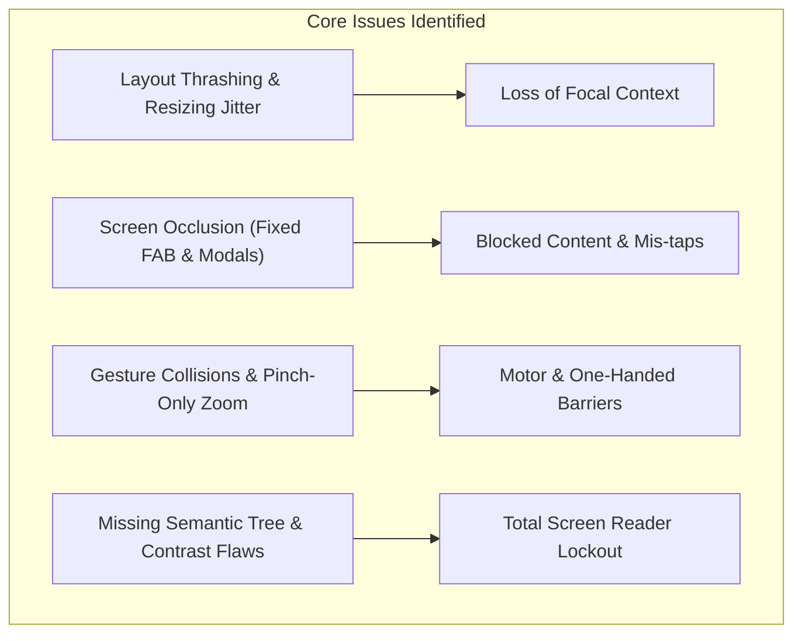
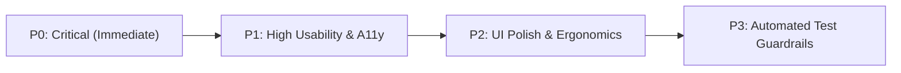

# PdfCraft Mobile: End-to-End Interaction Model & Accessibility (a11y) Audit

**Audit Date:** October 2026  
**Auditors:** Antigravity Principal UX & Mobile System Architect + Flutter Accessibility Specialist  
**Target Codebase:** [`pdfcraft-mobile`](file:///home/sujay/Downloads/pdfcraft-mobile)  
**Standards:** WCAG 2.1 / 2.2 AA & AAA, Section 508, Material Design 3, iOS Human Interface Guidelines  

---

## Executive Summary

This comprehensive audit investigates the core interaction model of PdfCraft Mobile, fully aligned with the latest working tree (including the staged `TOUCH_REDESIGN_PLAN.md` additions: [`CropPage`](file:///home/sujay/Downloads/pdfcraft-mobile/lib/widgets/crop_page.dart), [`LinksScreen`](file:///home/sujay/Downloads/pdfcraft-mobile/lib/widgets/links_screen.dart), and [`SignatureStore`](file:///home/sujay/Downloads/pdfcraft-mobile/lib/services/signature_store.dart)).

Specifically examining:
1. **Viewport & Canvas Stability:** How peripheral chrome, toolbars, search bars, and sheets disrupt and resize the primary document canvas ("layout thrashing").
2. **Screen Occlusion & Real Estate Starvation:** How floating buttons, heavy bottom navigation bars, and modal dialogs obstruct content or isolate the user from document context.
3. **Gesture Collisions & Motor Inaccessibility:** How multi-touch pinch-to-zoom, single-finger swipes, panning, and selection handles compete on the same physical touch surface without single-pointer alternatives.
4. **Assistive Technology & Screen Readers:** How raster-rendered PDF canvases without semantic trees lock out users relying on TalkBack, VoiceOver, and switch controllers.

> [!NOTE]
> **Code Alignment Verified:** All audit findings, file paths, and line references are grounded in the active staged codebase (HEAD + latest touch redesign passes, `cargo test` verified). None of the recent feature additions or engine tools are reverted or broken.



---

## 1. Architectural & Interaction Model Failures

### 1.1 Viewport Thrashing & Loss of Focal Context
* **Location:** [`lib/main.dart#L1992-L2044`](file:///home/sujay/Downloads/pdfcraft-mobile/lib/main.dart#L1992-L2044), [`lib/widgets/annotate_page.dart#L1033-L1080`](file:///home/sujay/Downloads/pdfcraft-mobile/lib/widgets/annotate_page.dart#L1033-L1080)
* **The Mechanism:**
  In [`main.dart`](file:///home/sujay/Downloads/pdfcraft-mobile/lib/main.dart), the central PDF reader sits in an `Expanded` widget inside a vertical `Column`.
  - When in-document search opens, [`FindBar`](file:///home/sujay/Downloads/pdfcraft-mobile/lib/widgets/find_bar.dart#L115) (~60dp) is injected into the column above the document.
  - When text is selected, the bottom styling sheet ([`Material`](file:///home/sujay/Downloads/pdfcraft-mobile/lib/main.dart#L2294-L2389), ~180dp) is injected into the column below the document.
  - When on-screen virtual keyboards appear, the column shrinks further.
* **The UX Failure:**
  The viewport height (`constraints.maxHeight`) changes drastically. The app immediately recalculates:
  $$\text{fitScale} = \min\left(\frac{\text{viewportWidth}}{\text{pageWidth}}, \frac{\text{viewportHeight}}{\text{pageHeight}}\right)$$
  **The entire PDF document instantly shrinks, leaps vertically, and rescales while the user is looking at or touching it.** Selection handles jump out from under the user's fingertips, and zoom focal points shift abruptly.

> [!WARNING]
> Dynamic resizing of the primary document canvas when accessory tools activate is the #1 cause of user disorientation and accidental touches in reader applications. Toolbars must overlay or dock without altering canvas geometry.

---

### 1.2 Permanent Occlusion by Floating UI ("The FAB Problem")
* **Location:** [`lib/main.dart#L2453-L2461`](file:///home/sujay/Downloads/pdfcraft-mobile/lib/main.dart#L2453-L2461)
* **The Mechanism:**
  The "Ask" AI command button is hardcoded as:
  ```dart
  Positioned(
    right: 16,
    bottom: 180,
    child: FloatingActionButton.extended(
      heroTag: 'pdfcraft-agent-command',
      ...
    ),
  )
  ```
* **The UX Failure:**
  - In PDF documents, the bottom-right quadrant is standard placement for page numbering, legal disclaimers, footnote citations, tables, and signature lines.
  - The FAB permanently floats directly over this reading surface.
  - Any user attempting to touch, drag, or pan near the lower-right quadrant will accidentally tap the FAB and launch the Agent Command modal.
  - **Redundancy:** The app already provides an "Agent" tab on the bottom `NavigationBar` ([`main.dart#L2410`](file:///home/sujay/Downloads/pdfcraft-mobile/lib/main.dart#L2410)). Two prominent controls on the same screen trigger the identical dialog.

---

### 1.3 Bottom Navigation Bar Misalignment with Material 3 Standards
* **Location:** [`lib/main.dart#L2392-L2414`](file:///home/sujay/Downloads/pdfcraft-mobile/lib/main.dart#L2392-L2414), [`lib/main.dart#L1829-L1877`](file:///home/sujay/Downloads/pdfcraft-mobile/lib/main.dart#L1829-L1877)
* **The Mechanism:**
  Tapping destinations (`Read`, `Edit`, `Organize`) on the bottom `NavigationBar` does not navigate between app views. Instead, [`_openSurface`](file:///home/sujay/Downloads/pdfcraft-mobile/lib/main.dart#L1730) triggers a modal action picker sheet ([`_chooseSurfaceAction`](file:///home/sujay/Downloads/pdfcraft-mobile/lib/main.dart#L1829)), which then launches another dialog or screen.
* **The UX Failure:**
  - A `NavigationBar` in mobile UX represents **persistent top-level views**, not popup menu buttons.
  - Users expect tapping "Edit" to toggle edit mode, not to launch a disruptive bottom modal that obscures the document they were reading.
  - Screen readers announce navigation destinations as "Tab, 1 of 4", leading users to expect a tab switch rather than a popup modal.

---

### 1.4 Modal Disconnect vs. Direct Canvas Manipulation
* **Location:** [`lib/widgets/text_edit_sheet.dart`](file:///home/sujay/Downloads/pdfcraft-mobile/lib/widgets/text_edit_sheet.dart), [`lib/widgets/form_screen.dart`](file:///home/sujay/Downloads/pdfcraft-mobile/lib/widgets/form_screen.dart)
* **The Mechanism:**
  Editing text or filling forms removes the user from the main canvas and places them inside an isolated bottom modal sheet or detached form list.
* **The UX Failure:**
  - In [`form_screen.dart`](file:///home/sujay/Downloads/pdfcraft-mobile/lib/widgets/form_screen.dart), fields are presented as an abstract list of text inputs and checkboxes with technical names like `"Field_1"`, completely detached from the visual PDF layout. The user cannot see what box or section they are filling in.
  - In [`text_edit_sheet.dart`](file:///home/sujay/Downloads/pdfcraft-mobile/lib/widgets/text_edit_sheet.dart), the PDF is rendered inside a modal sheet at $\sim 85\%$ screen height **with no `InteractiveViewer` zoom capability**. Users must tap microscopic paragraph text without the ability to zoom in.

---

## 2. Screen-by-Screen Detailed Audit

| Screen / Component | File Link | Primary Flaws | Impact |
| :--- | :--- | :--- | :--- |
| **Main PDF Viewer** | [`main.dart`](file:///home/sujay/Downloads/pdfcraft-mobile/lib/main.dart) | • Viewport reflows on tool activation<br>• FAB blocks bottom-right content during reading<br>• Pinch-to-zoom only (no buttons)<br>• NavigationBar acts as menu trigger | High layout jitter, accidental clicks, motor exclusion |
| **Annotation Canvas** | [`annotate_page.dart`](file:///home/sujay/Downloads/pdfcraft-mobile/lib/widgets/annotate_page.dart) | • Dynamic tool cluster rows push canvas up and down<br>• `_DraftPainter` strokes lack semantic labels<br>• Multi-touch conflict with pan gestures | Disorienting canvas shift, screen reader invisibility |
| **Crop Page Tool** | [`crop_page.dart`](file:///home/sujay/Downloads/pdfcraft-mobile/lib/widgets/crop_page.dart) | • **Zero zoom ability** (`InteractiveViewer` missing)<br>• Drag box on small phone screen lacks fine-grain nudge/zoom<br>• Missing selection semantics | Imprecise crop bounds on fine margins or tables |
| **Links Screen** | [`links_screen.dart`](file:///home/sujay/Downloads/pdfcraft-mobile/lib/widgets/links_screen.dart) | • Clean accessible list structure with tooltips<br>• Destination URLs lack explicit link semantic role | Minor a11y polish needed |
| **Text Editing Sheet** | [`text_edit_sheet.dart`](file:///home/sujay/Downloads/pdfcraft-mobile/lib/widgets/text_edit_sheet.dart) | • **Zero zoom ability** (`InteractiveViewer` missing)<br>• 42px touch proximity requirement on tiny text<br>• Missing close button tooltip | Extremely difficult touch targeting ("fat-finger" lock) |
| **Form Filling Screen** | [`form_screen.dart`](file:///home/sujay/Downloads/pdfcraft-mobile/lib/widgets/form_screen.dart) | • Completely detached from visual PDF<br>• Missing visual coordinate references<br>• Unlabeled form dialog controls | Cognitive friction, inability to verify field context |
| **Signature Placement** | [`signature_placement_page.dart`](file:///home/sujay/Downloads/pdfcraft-mobile/lib/widgets/signature_placement_page.dart) | • **Zero zoom ability** (`InteractiveViewer` missing)<br>• Blind touch placement with no drag/nudge handles<br>• No keyboard or switch positioning | Imprecise signature placement, switch inaccessible |
| **Quick Mark Tool** | [`quick_mark_page.dart`](file:///home/sujay/Downloads/pdfcraft-mobile/lib/widgets/quick_mark_page.dart) | • **Zero zoom ability**<br>• Single-tap stamp placement without zoom preview<br>• No semantic confirmation | High error rate on small documents |
| **Page Grid & Organizer** | [`page_grid.dart`](file:///home/sujay/Downloads/pdfcraft-mobile/lib/widgets/page_grid.dart) | • Grid cells lack `Semantics`<br>• Active page identified by color alone<br>• Card tap target collides with card menu icon | Screen reader blind spot, color blindness barrier |
| **Find & Search Bar** | [`find_bar.dart`](file:///home/sujay/Downloads/pdfcraft-mobile/lib/widgets/find_bar.dart) | • Injects into column, shrinking canvas<br>• 4 icons + label crammed into one row<br>• Match count not marked as `liveRegion` | Canvas jump, crowded touch targets, silent search updates |
| **Comment Threads** | [`comments_screen.dart`](file:///home/sujay/Downloads/pdfcraft-mobile/lib/widgets/comments_screen.dart) | • `Wrap` has 0dp spacing between action buttons<br>• `TextField` lacks `labelText`<br>• Pins on main canvas lack button semantics | Touch misses, screen reader announcements incomplete |
| **Signature Pad** | [`signature_pad.dart`](file:///home/sujay/Downloads/pdfcraft-mobile/lib/widgets/signature_pad.dart) | • Hardcoded white canvas & black stroke (dark mode glare)<br>• No alternative switch to type signature | Glare in dark mode, motor exclusion |
| **Bookmarks / Outline** | [`bookmarks_screen.dart`](file:///home/sujay/Downloads/pdfcraft-mobile/lib/widgets/bookmarks_screen.dart) | • Dialog inputs lack proper `labelText`<br>• Depth hierarchy announced as flat list | Navigational ambiguity for assistive tech |
| **Export & Compression** | [`export_sheet.dart`](file:///home/sujay/Downloads/pdfcraft-mobile/lib/widgets/export_sheet.dart) | • Progress updates not announced to screen readers<br>• Small preview container (~34% height) | Silent background task updates |

---

## 3. WCAG Accessibility (a11y) Violations

### 3.1 [CRITICAL] WCAG 2.5.1 Pointer Gestures (Level A)
* **Violation:** Multi-point pinch gesture required to zoom without single-pointer equivalent.
* **Code Reference:** [`main.dart#L2114-L2120`](file:///home/sujay/Downloads/pdfcraft-mobile/lib/main.dart#L2114-L2120), [`annotate_page.dart#L1109-L1113`](file:///home/sujay/Downloads/pdfcraft-mobile/lib/widgets/annotate_page.dart#L1109-L1113)
* **Impact:** Users with tremors, motor impairments, head pointers, single-switch controls, or those operating the device one-handed cannot zoom into documents.
* **Remediation:** Provide on-screen Zoom In (`+`), Zoom Out (`-`), and Reset Zoom (`100%`) buttons, plus double-tap-to-zoom support.

### 3.2 [CRITICAL] WCAG 1.1.1 Non-text Content (Level A)
* **Violation:** Core PDF rendering and annotation canvases completely lack `Semantics`.
* **Code Reference:** [`main.dart#L2145`](file:///home/sujay/Downloads/pdfcraft-mobile/lib/main.dart#L2145), [`annotate_page.dart#L1209`](file:///home/sujay/Downloads/pdfcraft-mobile/lib/widgets/annotate_page.dart#L1209)
* **Impact:** `Image.memory` and `CustomPaint` are rendered as blank uninformative nodes to TalkBack and VoiceOver. Users who are blind or have low vision receive no information regarding page numbers, content presence, or interactive status.
* **Remediation:** Wrap page containers with `Semantics(image: true, label: 'Document page X of Y')`.

### 3.3 [HIGH] WCAG 2.5.5 / 2.5.8 Target Size (Level AA / AAA)
* **Violation:** Text selection drag handles are undersized at $44\times 44\,\text{dp}$.
* **Code Reference:** [`main.dart#L2084-L2086`](file:///home/sujay/Downloads/pdfcraft-mobile/lib/main.dart#L2084-L2086), [`annotate_page.dart#L1148-L1150`](file:///home/sujay/Downloads/pdfcraft-mobile/lib/widgets/annotate_page.dart#L1148-L1150)
* **Impact:** Both Material 3 and Android accessibility guidelines require a minimum of $48\times 48\,\text{dp}$ touch bounding boxes. Selection handles frequently fail to register drag initiation.
* **Remediation:** Expand hit target dimensions to $48\times 48\,\text{dp}$ while preserving the visual $16\,\text{dp}$ circular handle.

### 3.4 [HIGH] WCAG 1.4.11 Non-text Contrast & 1.4.1 Use of Color (Level AA / A)
* **Violation:** Pure yellow text highlights on white backgrounds have a contrast ratio of only **1.07:1** (minimum requirement is 3:1). Active page in `PageGrid` is represented exclusively by a border color.
* **Code Reference:** [`main.dart#L2201-L2214`](file:///home/sujay/Downloads/pdfcraft-mobile/lib/main.dart#L2201-L2214), [`page_grid.dart#L554-L560`](file:///home/sujay/Downloads/pdfcraft-mobile/lib/widgets/page_grid.dart#L554-L560)
* **Impact:** Low-vision and color-blind users cannot perceive selection boundaries or determine active page status.
* **Remediation:** Use darker amber borders (`#C79100`) for selection highlights and add a visible "Current" badge on active grid thumbnails.

### 3.5 [HIGH] WCAG 4.1.2 Name, Role, Value & 1.1.1 Non-text Content (Level A)
* **Violation:** Pagination buttons and dialog close buttons lack tooltips; text fields use `hintText` instead of `labelText`.
* **Code Reference:** [`main.dart#L2434-L2444`](file:///home/sujay/Downloads/pdfcraft-mobile/lib/main.dart#L2434-L2444), [`page_grid.dart#L437`](file:///home/sujay/Downloads/pdfcraft-mobile/lib/widgets/page_grid.dart#L437), [`find_bar.dart#L125`](file:///home/sujay/Downloads/pdfcraft-mobile/lib/widgets/find_bar.dart#L125)
* **Impact:** TalkBack announces "Button" without indicating direction or purpose. Screen readers do not announce input expectations once typing begins.
* **Remediation:** Add `tooltip: 'Previous page'` / `tooltip: 'Next page'` and standardize all input decorations to use `labelText`.

---

## 4. Architectural Target: The Stable-Canvas Overlay Model

To eliminate viewport thrashing, screen occlusion, and accessibility barriers, the app architecture should transition to a **Stable-Canvas Overlay Architecture**:

```
┌───────────────────────────────────────────────────────────┐
│                     Top App Bar                           │
├───────────────────────────────────────────────────────────┤
│                                                           │
│                  PERMANENT STABLE VIEWPORT                │
│             (Geometry NEVER resizes on tool open)         │
│                                                           │
│   ┌───────────────────────────────────────────────────┐   │
│   │ [Floating Find HUD]  [ 1 / 14 matches ]   [X]     │   │
│   └───────────────────────────────────────────────────┘   │
│                                                           │
│                      PDF DOCUMENT                         │
│                  InteractiveViewer Canvas                 │
│                                                           │
│   ┌────────┐                                              │
│   │ Zoom + │                                              │
│   │ Zoom - │                                              │
│   │ Reset  │                                              │
│   └────────┘                                              │
│                                                           │
│   ┌───────────────────────────────────────────────────┐   │
│   │ [Floating Text Selection Bar: Highlight / Copy]   │   │
│   └───────────────────────────────────────────────────┘   │
├───────────────────────────────────────────────────────────┤
│   Bottom Tool Deck / Surface Mode Bar  (Read | Annotate)  │
├───────────────────────────────────────────────────────────┤
│   Pagination Row (< Page 1 / 12 >) + Context Actions      │
└───────────────────────────────────────────────────────────┘
```

### Key Architectural Shifts:
1. **Never mutate canvas constraints:** `FindBar`, `TextSelectionControls`, and color pickers must be rendered as floating overlays inside a `Stack`, positioned above or below the canvas without shrinking `constraints.maxHeight`.
2. **Eliminate the floating "Ask" FAB:** Remove the floating button from the reading surface. Integrate agent commands directly into the bottom control tier or app bar action menu.
3. **Add `InteractiveViewer` across all modal canvases:** Integrate zoom into `TextEditSheet`, `SignaturePlacementPage`, and `QuickMarkPage` so users never have to tap microscopic text without magnification.
4. **Explicit Mode Switching:** Replace ambiguous gesture arenas with explicit toolbar states:
   - *Read Mode:* 1-finger swipe turns pages, pinch zooms, accessible zoom buttons available.
   - *Select/Edit Mode:* 1-finger drag selects text, pan disabled or two-finger only.

---

## 5. Prioritized Remediation Roadmap



### Phase 1: Immediate Critical Fixes (P0)
- [ ] **Stabilize Viewport:** Convert [`FindBar`](file:///home/sujay/Downloads/pdfcraft-mobile/lib/widgets/find_bar.dart) and Text Selection panels from `Column` children to floating overlay bars in `Stack` so the document never resizes or leaps.
- [ ] **Remove Occluding FAB:** Remove the `Positioned` FAB in [`main.dart#L2453`](file:///home/sujay/Downloads/pdfcraft-mobile/lib/main.dart#L2453) and integrate the action cleanly into the bottom bar and app bar.
- [ ] **Add Single-Pointer Zoom Controls:** Add on-screen Zoom In / Zoom Out / Reset buttons to fulfill WCAG 2.5.1.
- [ ] **Add Canvas Zoom to Sub-screens:** Wrap canvases in [`text_edit_sheet.dart`](file:///home/sujay/Downloads/pdfcraft-mobile/lib/widgets/text_edit_sheet.dart) and [`signature_placement_page.dart`](file:///home/sujay/Downloads/pdfcraft-mobile/lib/widgets/signature_placement_page.dart) with `InteractiveViewer`.

### Phase 2: High Usability & Accessibility (P1)
- [ ] **Semantic Tree Coverage:** Wrap page images in `Semantics(image: true, label: ...)` and comment markers in `Semantics(button: true)`.
- [ ] **Touch Target Compliance:** Expand selection handles to $48\times 48\,\text{dp}$ touch bounds.
- [ ] **Missing Tooltips & Labels:** Add tooltips to pagination chevrons (`chevron_left`, `chevron_right`) and sheet close buttons; replace `hintText` with `labelText` on all input fields.
- [ ] **Color Contrast Remediation:** Darken yellow text highlights to high-contrast amber (`#C79100`); add text badges for active grid pages.

### Phase 3: Ergonomics & Polish (P2)
- [ ] **Live Regions:** Mark search counts (`1 of 14`) and background task progress bars as `Semantics(liveRegion: true)`.
- [ ] **Theme-Aware Signature Pad:** Replace hardcoded white/black palette in [`signature_pad.dart`](file:///home/sujay/Downloads/pdfcraft-mobile/lib/widgets/signature_pad.dart) with theme-aware background and stroke colors.
- [ ] **Modal Separation:** Refactor bottom `NavigationBar` into true persistent surfaces or an explicit docked tool drawer.

### Phase 4: Automated Verification (P3)
- [ ] Add `test/accessibility_test.dart` to verify `meetsGuideline(androidTapTargetGuideline)`, `meetsGuideline(iOSTapTargetGuideline)`, and `meetsGuideline(labeledTapTargetGuideline)` in CI.
