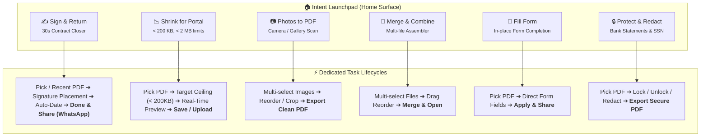
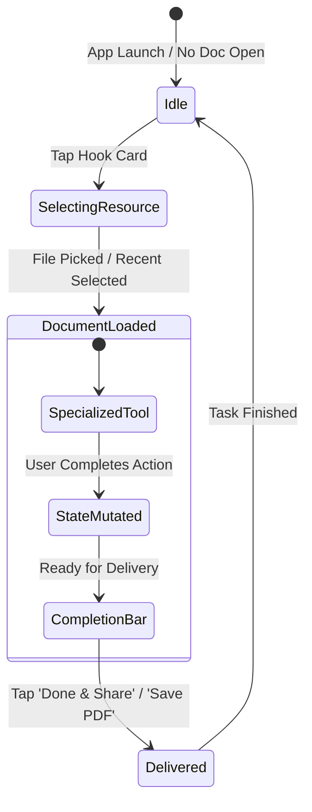

# Multi-Wedge Intent Architecture & Modular Hook Engine Specification

**Document Version:** 1.0.0  
**Target Milestone:** Touch-First Viral Growth Overhaul  
**Target Platform:** Flutter (Android/iOS) + Native Rust Engine (`pdfcraft-mobile-api`)  
**Design Principle:** *Outcome-First, Zero-Friction Utility — 100% On-Device, Zero Paywalls.*

---

## 1. Executive Summary & Strategic Rationale

### 1.1 The Mobile Utility Dilemma
Traditional mobile PDF applications are designed as **desktop software catalogues scaled down to phone screens**. They present empty gray viewers, multi-tiered drawer menus, and 82%-height bottom sheets cataloging dozens of equal features.

However, modern app store analytics and user research reveal a stark reality:
> **Nobody browses an app store seeking an "extensive document management framework."**  
> Mobile users download a PDF utility exclusively in moments of **acute urgency, deadline pressure, or task failure**.

Common triggers include:
1. *A government or university portal rejects an upload:* `"File size exceeds 200 KB (or 2 MB)."`
2. *A landlord, employer, or client sends an agreement over WhatsApp:* `"Sign and return in 10 minutes."`
3. *A sensitive tax form or bank statement must be filled or unlocked:* Online web converters demand cloud uploads of confidential data; mainstream commercial apps lock the final "Download" button behind a $15/month subscription.

### 1.2 The Multi-Wedge Strategy
Rather than selecting a single niche hook and discarding the remaining engine capabilities, PdfCraft Mobile implements the **Multi-Wedge (Modular Utility) Architecture**.

Every high-intent capability is extracted from deep sub-menus and elevated into an **independent, self-contained, outcome-driven flow lifecycle**.



---

## 2. The 6 Dedicated Hook Lifecycles

Each hook operates with an autonomous state machine containing 4 unified phases:
1. **Trigger & Context Acquisition**: Initiated via Home Launchpad, Recent Document action, or Native Intent handoff (`ACTION_VIEW`).
2. **Resource Resolution**: Document loaded from disk, recents cache, or system picker.
3. **Focused Action Surface**: Direct navigation to the dedicated editing tool without intermediate catalogues.
4. **Immediate Outcome Action**: Unified completion path (**Done & Share**, **Save PDF**, or **Apply**).



### 2.1 Hook 1: ✍️ Sign & Return (30-Second Contract Closer)
- **Primary Persona:** Working professionals, freelancers, tenants, contractors receiving documents on messaging apps.
- **Trigger Points:**
  - Launchpad card: `Sign & Return`.
  - Contextual banner on incoming WhatsApp PDF.
  - Recent document tile shortcut.
- **Workflow Steps:**
  1. If document not active: File picker opens filtered to `.pdf` (or loads clicked recent).
  2. Directly opens `SignaturePlacementPage` with pre-cached signature from `SignatureStore`.
  3. User taps position on page $\rightarrow$ Signature placed $\rightarrow$ Single tap on `[ Add Date ]` stamps current formatted date.
  4. Bottom bar surfaces primary `[ Done & Share PDF ]` button.
  5. System share sheet immediately launches with target WhatsApp / Email thread.
- **Success Metric:** Time-to-Share $< 30\text{ seconds}$ from app icon tap.

### 2.2 Hook 2: 📉 Shrink for Portal (Target-Size Compressor)
- **Primary Persona:** Students, job applicants, visa candidates, government exam applicants facing strict upload ceilings (e.g., UPSC, SSC, state portals, college admissions).
- **Trigger Points:**
  - Launchpad card: `Shrink for Portal`.
  - Direct quick action on recent file.
- **Workflow Steps:**
  1. Pick document or select recent.
  2. Opens `ExportSheet` directly pinned to the **Compress Mode** tab.
  3. Pre-configured one-tap target ceiling chips:
     - `[ < 200 KB ]` (Strict government/exam threshold)
     - `[ < 500 KB ]` (Standard application portal limit)
     - `[ < 1 MB ]` (Email attachment target)
     - `[ < 2 MB ]` (Enterprise upload limit)
     - `[ Custom KB ]` (Exact numerical input)
  4. Engine runs Rust multi-strategy compression (Flate re-encoding, image downsampling, font subsetting, metadata stripping) in-memory.
  5. Live before-and-after comparison slider displayed with exact byte count.
  6. Primary action: `[ Save Compressed PDF ]` or `[ Share / Upload ]`.

### 2.3 Hook 3: 📷 Photos to Clean PDF (Document Scanner)
- **Primary Persona:** Students archiving lecture notes, drivers photographing receipts, field workers digitizing paper contracts.
- **Workflow Steps:**
  1. Launchpad card triggers multi-image file picker (camera or gallery).
  2. Direct transition into `OrganizeSheet` (Images-to-PDF workspace).
  3. Touch-friendly grid with drag-and-drop page reordering and 90° rotation controls.
  4. 1-tap `[ Generate PDF ]` invokes engine tool `create_from_images`.
  5. Document loads directly into the reader with immediate Share availability.

### 2.4 Hook 4: 📑 Merge & Combine (Multi-File Joiner)
- **Primary Persona:** Applicants needing to combine ID, resume, and certificates into a single consolidated dossier.
- **Workflow Steps:**
  1. Launchpad card triggers multi-file document picker.
  2. Staged files listed in a touch-reorderable vertical list with individual page counts.
  3. Tap `[ Combine Files ]` invokes engine tool `pages_merge`.
  4. Resulting merged PDF instantly opens with save/share prompts.

### 2.5 Hook 5: 📝 Fill Form (In-Place Form Filler)
- **Primary Persona:** Parents, employees, and patients filling out school, tax, or medical forms on mobile devices.
- **Workflow Steps:**
  1. Pick PDF $\rightarrow$ Direct navigation into `FormScreen`.
  2. Auto-parsed form fields presented in ergonomic list view with native keyboard next-focus actions.
  3. Tap `[ Apply ]` commits changes to engine session and returns to viewer with updated render.

### 2.6 Hook 6: 🔒 Protect & Redact (Bank Statements & Privacy Vault)
- **Primary Persona:** Users needing to unlock password-protected bank statements, apply encryption before emailing, or permanently black out sensitive PII (SSNs, bank account numbers).
- **Workflow Steps:**
  1. Pick PDF $\rightarrow$ Direct navigation into `SecureSheet` or `AnnotatePage(mode: redact)`.
  2. Encrypt with AES-256 password, strip existing password protection, or draw permanent redaction boxes.
  3. Export sanitized document.

---

## 3. UI Architecture: The Intent Launchpad

### 3.1 Layout & Visual Hierarchy
When no document is active, `_emptyDocumentHome()` is replaced by the **Intent Launchpad** composed of three visual layers:

```
┌────────────────────────────────────────────────────────┐
│ [🛡️] 100% On-Device · Private Rust Core · Zero Paywall │
│                                                        │
│               PdfCraft Mobile                          │
│               Choose a task to get started             │
├────────────────────────────────────────────────────────┤
│ HERO INTENT GRID (2x3 Touch Cards)                     │
│ ┌──────────────────────────┐┌──────────────────────────┤
│ │ ✍️ Sign & Return          ││ 📉 Shrink for Portal     ││
│ │ 30s contract closer      ││ < 200 KB, < 2 MB limits  ││
│ └──────────────────────────┘└──────────────────────────┤
│ ┌──────────────────────────┐┌──────────────────────────┤
│ │ 📷 Photos to PDF         ││ 📑 Merge & Combine       ││
│ │ Multi-image scanner      ││ Combine multiple files   ││
│ └──────────────────────────┘└──────────────────────────┤
│ ┌──────────────────────────┐┌──────────────────────────┤
│ │ 📝 Fill Form             ││ 🔒 Protect & Redact      ││
│ │ Tax & school forms       ││ Passwords & blackout PII ││
│ └──────────────────────────┘└──────────────────────────┘
├────────────────────────────────────────────────────────┤
│ RECENT DOCUMENTS (Quick Action Tiles)                  │
│ [📄] W4_Form_2026.pdf (2 pages · 140 KB)               │
│      [ ✍️ Sign ]  [ 📉 Shrink ]  [ 📤 Share ]          │
├────────────────────────────────────────────────────────┤
│ [ 📂 Open Any PDF ]  (Full Reader & Explorer)          │
└────────────────────────────────────────────────────────┘
```

### 3.2 Design System Specifications
- **Touch Target Sizing:** All launchpad cards and action buttons maintain minimum $56\times 56\text{ dp}$ bounding boxes (exceeding WCAG 2.2 AA $48\times 48\text{ dp}$).
- **Elevation & Feedback:** Material 3 card tokens with `cardTheme.elevation = 1.0`, interactive `InkWell` ripple, and `HapticFeedback.selectionClick()` on tap.
- **Accessibility:** Explicit semantic labels (`Semantics(button: true, label: "...")`) with full TalkBack/VoiceOver task descriptions.

---

## 4. Technical Architecture & Code Implementation Plan

### 4.1 Flow Launcher Orchestration (`lib/main.dart`)

```dart
/// Dedicated Hook Launchers
extension HookLaunchers on _ViewerPageState {
  /// Hook 1: Sign & Return
  Future<void> _flowSignDocument({RecentDocument? recent}) async {
    final doc = recent != null 
        ? await _openRecent(recent) 
        : await _pickAndOpenDocument();
    if (doc == null || !mounted) return;
    final outcome = await _openSignature();
    // SignaturePlacementPage already handles 'Done & Share' handoff
  }

  /// Hook 2: Shrink for Portal
  Future<void> _flowCompressForPortal({RecentDocument? recent}) async {
    final doc = recent != null 
        ? await _openRecent(recent) 
        : await _pickAndOpenDocument();
    if (doc == null || !mounted) return;
    await _openExport(initialAction: 'compress');
  }

  /// Hook 3: Photos to PDF
  Future<void> _flowPhotosToPdf() async {
    await _openOrganize(initialAction: 'images');
  }

  /// Hook 4: Merge & Combine
  Future<void> _flowCombinePdfs() async {
    await _openOrganize(initialAction: 'combine');
  }

  /// Hook 5: Fill Form
  Future<void> _flowFillForm({RecentDocument? recent}) async {
    final doc = recent != null 
        ? await _openRecent(recent) 
        : await _pickAndOpenDocument();
    if (doc == null || !mounted) return;
    await _openForms();
  }

  /// Hook 6: Protect & Redact
  Future<void> _flowProtectOrRedact({RecentDocument? recent}) async {
    final doc = recent != null 
        ? await _openRecent(recent) 
        : await _pickAndOpenDocument();
    if (doc == null || !mounted) return;
    await _openSecure();
  }
}
```

### 4.2 Helper Method: Unified File Ingestion (`_pickAndOpenDocument`)
Extract file picking and opening logic into a clean, reusable helper that returns the opened document handle `int?`:

```dart
Future<int?> _pickAndOpenDocument() async {
  final files = await FilePickerPlatform.instance.pickFiles(
    type: FileType.custom,
    allowedExtensions: ['pdf'],
  );
  if (!mounted || files.isEmpty) return null;
  final file = files.first;
  final bytes = await file.readAsBytes();
  if (!mounted || bytes.isEmpty) return null;
  return await _openDocumentBytes(file.name, bytes);
}
```

### 4.3 Native Intent Handoff Banner (`ACTION_VIEW` Ingestion)
When a PDF is received via Android Intent, present an inline **Task Intent Pill Bar** above the document canvas:

```dart
Widget _buildIncomingIntentBanner() {
  return Material(
    elevation: 2,
    color: Theme.of(context).colorScheme.primaryContainer,
    child: Padding(
      padding: const EdgeInsets.symmetric(horizontal: 16, vertical: 8),
      child: Row(
        children: [
          Icon(Icons.bolt, color: Theme.of(context).colorScheme.onPrimaryContainer),
          const SizedBox(width: 8),
          Text('Quick action:', style: TextStyle(fontWeight: FontWeight.bold)),
          const Spacer(),
          FilledButton.tonalIcon(
            onPressed: () => _openSignature(),
            icon: const Icon(Icons.draw, size: 16),
            label: const Text('Sign'),
          ),
          const SizedBox(width: 8),
          FilledButton.tonalIcon(
            onPressed: () => _openExport(initialAction: 'compress'),
            icon: const Icon(Icons.compress, size: 16),
            label: const Text('Shrink'),
          ),
        ],
      ),
    ),
  );
}
```

---

## 5. Verification & Testing Strategy

```
┌────────────────────────────────────────────────────────────────────────┐
│                        VERIFICATION MATRIX                             │
├──────────────────────┬─────────────────────────────────────────────────┤
│ Verification Area    │ Criteria & Method                               │
├──────────────────────┼─────────────────────────────────────────────────┤
│ 1. Flow Completion   │ Each of the 6 flows must reach its intended     │
│                      │ outcome without intermediate catalogue menus.   │
├──────────────────────┼─────────────────────────────────────────────────┤
│ 2. Cancellation      │ Dismissing a file picker or cancelling a tool   │
│                      │ must return cleanly to Launchpad without false  │
│                      │ snackbar notifications.                         │
├──────────────────────┼─────────────────────────────────────────────────┤
│ 3. Memory & Engine   │ Document handles must properly dispose previous │
│                      │ sessions without memory leaks in Rust runtime.  │
├──────────────────────┼─────────────────────────────────────────────────┤
│ 4. Accessibility     │ All 6 cards & recent shortcuts pass TalkBack    │
│                      │ inspection with >= 48x48dp touch targets.       │
├──────────────────────┼─────────────────────────────────────────────────┤
│ 5. Rust Engine Tests │ `cargo test -p pdfcraft-mobile-api` 100% green. │
└──────────────────────┴─────────────────────────────────────────────────┘
```

---

## 6. Execution Steps

1. **Document Approval**: Final review of this specification artifact.
2. **Launchpad Component Construction**: Build `LaunchpadCard` and modernized `_emptyDocumentHome()` in `lib/main.dart`.
3. **Flow Launcher Implementation**: Implement `_pickAndOpenDocument()` and the 6 hook methods.
4. **Recent Documents Enhancement**: Add direct quick-action buttons to `_recentDocuments` tiles.
5. **Syntax & Regression Testing**: Run automated bracket/syntax checks and Rust engine test suite.

